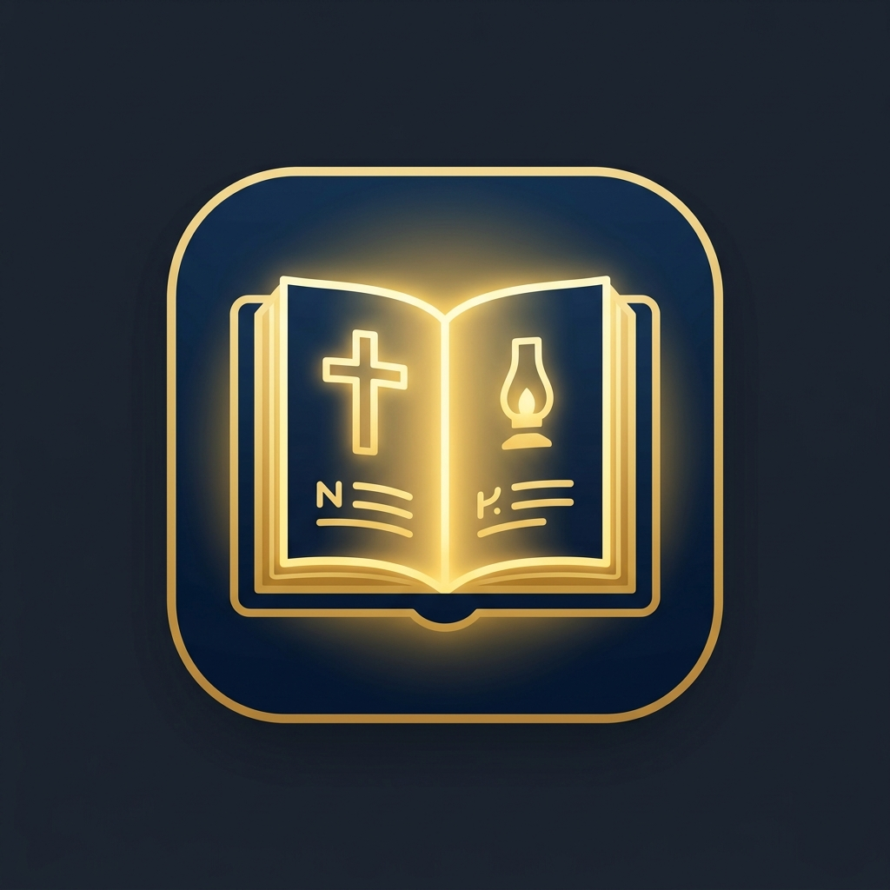

<div align="center">



# 📖 Macaafa Qulqulluu — Afaan Oromoo Bible

**A beautiful, full-featured desktop Bible application for the Afaan Oromoo (Oromo) language.**

[](https://opensource.org/licenses/MIT)
[](https://www.electronjs.org/)
[](https://react.dev/)
[](https://www.typescriptlang.org/)
[](https://vitejs.dev/)

[Download for Windows](#-download) · [Features](#-features) · [Run Locally](#-run-locally) · [Tech Stack](#%EF%B8%8F-tech-stack)


</div>

---

## ✨ Features

| Feature | Description |
|---|---|
| 📚 **Complete Bible** | All 66 books · 1,189 chapters · 31,067+ verses in Afaan Oromoo |
| 🌗 **3 Themes** | Dark, Light, and Sepia reading modes |
| 🔍 **Full-Text Search** | Search any word or phrase across the entire Bible |
| 🔖 **Bookmarks** | Save and revisit your favorite verses |
| 🖍️ **Verse Highlighting** | Highlight verses in 3 different colors |
| ✝️ **Cross-References** | See related verses for deeper study |
| 🤖 **Ibsa AI** | Built-in Gemini-powered AI assistant for verse explanation |
| 🌅 **Daily Verse** | A new verse is suggested every day |
| ⚙️ **Customization** | Adjust font size, font family, and line height |
| 🗂️ **Sidebar Toggle** | Collapsible sidebar for a focused reading experience |
| 💻 **Native Desktop** | Runs as a proper Windows desktop application via Electron |

---

## 💾 Download

Download the latest Windows installer from the [Releases](../../releases) page:

> **`Macaafa Qulqulluu Setup 1.0.0.exe`** — One-click installer for Windows

---

## 🚀 Run Locally

### Prerequisites
- [Node.js](https://nodejs.org/) v18 or higher
- npm v9 or higher

### Steps

```bash
# 1. Clone the repository
git clone https://github.com/HD-CMP/macaafa-qulqulluu.git
cd macaafa-qulqulluu

# 2. Install dependencies
npm install

# 3. Run in development mode (Electron + Vite HMR)
npm start

# 4. Build the Windows installer
npm run electron:build
# → Output: release/Macaafa Qulqulluu Setup 1.0.0.exe
```

---

## 🏗️ Tech Stack

| Layer | Technology |
|---|---|
| **UI Framework** | React 19 + TypeScript |
| **Build Tool** | Vite 8 |
| **Desktop Shell** | Electron 43 |
| **Installer** | electron-builder (NSIS) |
| **AI Integration** | Google Gemini AI (`@google/generative-ai`) |
| **Linting** | OXLint |

---

## 📁 Project Structure

```
macaafa-qulqulluu/
├── build/                  # App icon files (.png, .ico)
├── electron/
│   ├── main.js             # Electron main process
│   └── preload.js          # Context-bridge preload script
├── public/
│   ├── fullBible.json      # Complete Afaan Oromoo Bible data (5MB+)
│   └── icons.svg           # UI icon sprites
├── src/
│   ├── components/
│   │   └── AIPanel.tsx     # Ibsa AI assistant panel
│   ├── data/
│   │   ├── bibleBooks.ts   # Book metadata & daily verses
│   │   └── crossReferences.ts
│   ├── App.tsx             # Main application component
│   ├── aiService.ts        # Gemini AI service layer
│   ├── index.css           # Global styles & theme variables
│   └── main.tsx            # React entry point
├── index.html
├── package.json
└── vite.config.ts
```

---

## 🤖 Ibsa AI — AI-Powered Bible Companion

The built-in **Ibsa AI** (powered by Google Gemini) allows users to:
- Ask questions about any verse in **Afaan Oromoo or English**
- Get explanations, historical context, and theological insights
- Have a natural conversation about scripture

The AI has deep knowledge of the Afaan Oromoo Bible and responds contextually to selected verses.

---

## 🌍 About Afaan Oromoo

Afaan Oromoo (also known as Oromo) is spoken by over **40 million people** in East Africa, primarily in Ethiopia. It is one of the largest Cushitic languages in the world. This application is dedicated to making the Holy Scriptures accessible to Oromo speakers in their native language.

---

## 📄 License

This project is open source and available under the [MIT License](LICENSE).

---

<div align="center">

Made with ❤️ for the Oromo Community · by [HD-CMP](https://github.com/HD-CMP)

</div>
